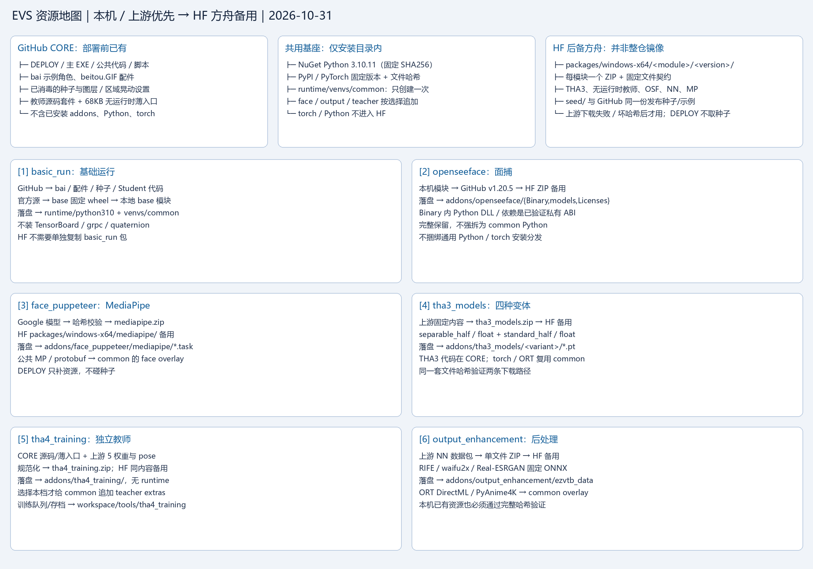
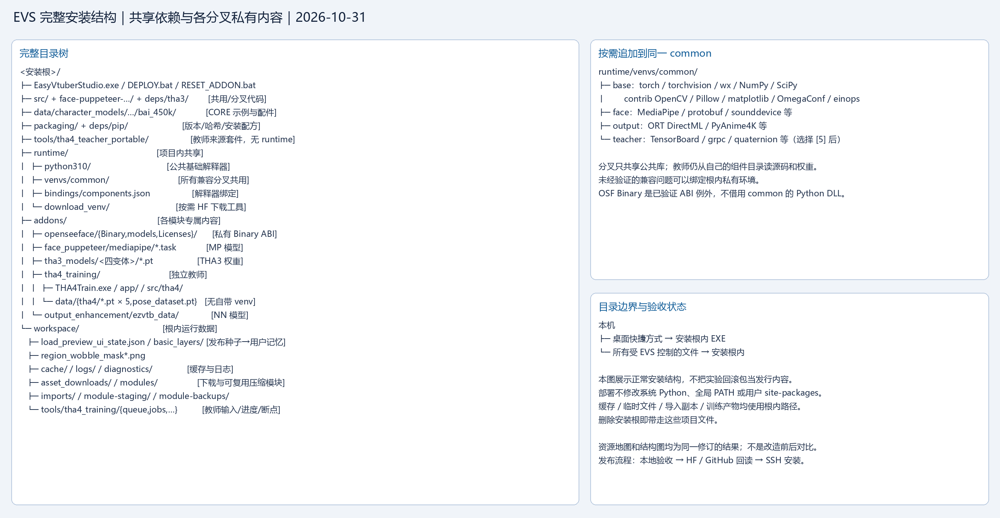

# 部署布局：本地修订 2026.10.31-r1

两张图分别是资源地图和完整实装结构，均对应本次修订。旧目标图已作为历史归档，不再据其移走 CORE 角色或剥离 OSF ABI。

CORE 自带 bai 示例、beitou GIF、消毒后的种子、公共代码与教师来源套件。教师薄入口可在源码套件与教师 ZIP 中重复存在，不包含 Python/torch；新机不用编译器也能装教师。普通 common 只含已选档位依赖；[5] 才加入教师 extras。

按模块白名单和文件哈希规范化上游下载，单文件 ZIP 放在 `packages/windows-x64/<module>/<version>/`。部署优先本机/上游，失败后才用 HF 方舟。OSF Binary 内已验证的 ABI 是私有例外；不强行剥离其 DLL。共享基座与各档位的划分以图及 `core_scope.json`、`runtime-artifacts.json`、`resource-lock.json` 为准。

Cursor 的共用实验已完成；本轮已修正复制环境的入口、精确安装配方、OpenCV 同名覆盖、回滚材料以及交接里的发行缺口。环境与重复部署已验收，并已在随后完成教师首次非零完整存档。发布采用验证后的 CORE 与模块白名单，先上传/回读 HF、再同步 GitHub；发布完成后按真实版本交给 Cursor 执行 SSH 安装验收。已有远端目录与旧独立教师实例保留。

SSH 阶段追加 Windows MCP 独立安装、交互桌面连接验证和全过程全屏原图采集，供图文教程发布；相关窗口尽量最大化，按用户确认不作隐私遮挡。具体执行与交付要求见 [阶段3-SSH部署与教程截图验收](阶段3-SSH部署与教程截图验收.md)，镜头顺序见 [初心者取材表](../beginner/00-SSH安装与首次启动取材表.md)。本项仍是待执行方案，不代表远程测试或截图已经完成。
